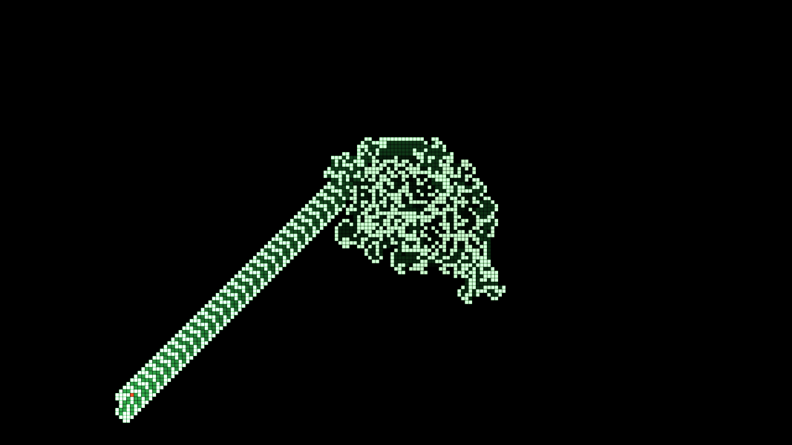
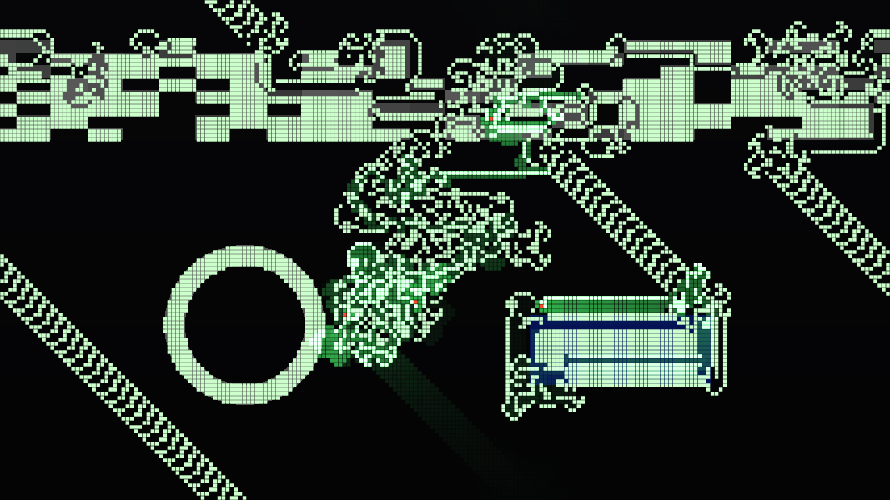
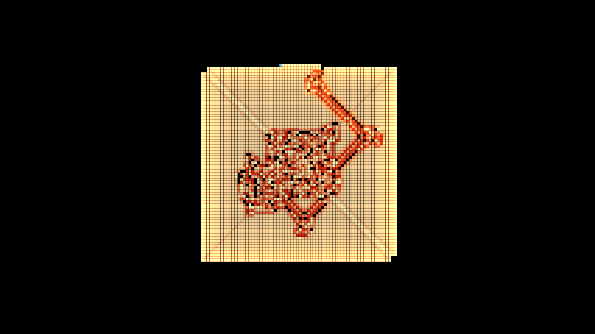

# langton

> **AI-assisted project.** This codebase was created with [Claude](https://claude.com/claude-code)
> (Anthropic), directed and reviewed by a human author. It has **never been loaded into
> Resolume**; it is loaded by [oxbow](https://github.com/stoatworks-labs/oxbow), a real FFGL
> host that is not Resolume. Everything below is measured by an offline harness that drives
> the real plugin classes in a headless GL context, on this Mac's GPU at two rasters and
> again on Apple's software renderer. `lntest --literature` finds Langton's ant on an empty
> grid **settling into its highway at step 9977** and repeating a 104-step cycle that moves
> it (−2, −2) every time, Turk and Propp's LLRR and RLLR ants **mirror-symmetric at every
> one of their 697 and 533 returns home** (RL at 1 of 15), and LRRRRRLLR **filling a
> square**. `--engine` holds the plugin's walk to the harness's own, cell for cell, for
> every rule, and `--highway` reads the GPU's state texture back after every frame and
> finds it is that walk. `--reverse` runs every rule out and back to its seed **exactly**.
> `lntest --negative` re-runs twelve checks against deliberately wrong models, and
> `tools/mutate.sh` changes one character of the shipped shaders and code; every one is
> caught. A control sweep fails if any parameter does nothing.

Langton's ant for Resolume Arena/Avenue, as two FFGL plugins: **SW Langton**, a source
in which one ant (or up to eight, and twelve-colour rules) walks an empty grid or a soup,
and **SW Langton Over**, an effect in which the ants walk your clip: its brightness is
the ground they read and repaint.

The source's defaults after 21.7 seconds (12,990 steps): ten thousand steps of
chaos, then the highway. Pale cells are the ant's colour 1; the darker cells are where it
has walked recently (the trail); the red cell is the ant. Rendered by the plugin's
offline harness (`lntest`), not captured from Resolume.

## The one idea

**An ant on a grid of black and white cells. On a white cell it turns right, on a black
one left; it flips the colour of the cell and steps forward.** That is the whole rule
(Christopher Langton, 1986), and nothing in the plugin draws a picture of an ant's walk:
the walk is the rule, run exactly, one step at a time, and what you see falls out of it.

- For about **ten thousand steps** the ant makes what looks like noise: a growing blob
  with no order anyone has found.
- Then, at step 9977 (from an empty grid), it starts building a **highway**: the same 104
  steps over and over, each cycle carrying it two cells diagonally, for ever.
- Give the colours more letters and you get **Turk and Propp's ants**: a rule like LLRR
  says turn left on colour 0, left on 1, right on 2, right on 3, then step the colour on.
  Rules made of pairs of equal letters (LLRR, RLLR) **grow symmetrically**; LRRRRRLLR
  **fills a square**; others make convoluted highways or stay chaotic.
- **The walk runs backwards exactly.** Each step can be undone (step back, colour back,
  turn back), so with Reverse on, ten thousand steps of chaos un-happen into the empty
  grid they came from.

In **SW Langton Over** the clip is the ground. When the field is seeded, each cell takes
the clip's brightness, cut into as many levels as the rule has colours, and the ants walk
it, turning by what the picture says and repainting it as they go; the clip shows through
behind.

SW Langton Over on the harness's test card (a lit skyline, a ring, a saturated blue
sign) after five seconds: four ants at 3000 steps a second. Rendered by `lntest`.

Turk and Propp's LRRRRRLLR, Heat palette, after 40,000 steps: it fills a square.

## Controls

- **Ants:** Rule (*Langton (RL)*, *LLRR*, *RLLR*, *LRRRRRLLR*, *LLRRRLRLRLLR*,
  *RRLLLRLLLRRR*, *RLR*: Wikipedia's examples of many-coloured ants), Ants (1–8; more ants
  take turns, the first in the middle facing up, the rest round it).
- **Time:** Speed (0 pauses; 1 to a million steps a second, each ant one step a round),
  Reverse (time runs backwards), Step (one round, by hand).
- **Seeding:** Pattern (*Empty*, *Soup*; the Over adds *Clip*), Density, Seed, Reseed.
- **Audio:** Audio (Resolume's FFT buffer), Audio Burst (rounds per onset, 10–100,000:
  the ants run on the beat), Audio Reverse (each onset turns time round).
- **Look:** Cell Size (16 rows to a cell per pixel at 1080p; the walk keeps its cells
  when you change it), Gap (dark space round each cell), Palette (*Phosphor*, *Heat*,
  *Ice*, *Mono*, *Spectrum*), Trail (how long a cell glows after an ant has stood on it, in
  ant steps), Show Ants; the Over adds Clip Colour (cells take the clip's colour), Backdrop
  (the clip behind the cells) and Mix.

The source is transparent where nothing is painted, so it layers over the composition
below it. Colour 0 is never drawn.

## Status

**v0.1.0, unreleased, and honestly early.** Built and measured on macOS (Apple Silicon,
M4 Max). It has **never been loaded into Resolume**: `oxbow probe` reads the bundles as a
host does (`SW Langton` / `LA01` / source, `SW Langton Over` / `LA02` / effect) and
`oxbow selftest` renders 120 frames through each. Never built on Windows. No OpenFX port.

What is measured, on this machine, at 1280x720 and 320x180 on the GPU and at 320x180 on
Apple's software renderer:

| | |
| --- | --- |
| the literature | on a 512x512 grid, the plugin's own walk: Langton's ant's turns repeat every 104 steps from step 9977 to 12,000, 19 whole cycles, each moving it (−2, −2); 720 black cells at step 10,000 and 834 at 11,000; LLRR and RLLR mirror-symmetric at all 697 and 533 of their returns home facing up in 20,000 steps (RL: 1 of 15); LRRRRRLLR's visited cells a square, 95.6–100% filled, from 20,000 to 160,000 steps; all seven rules 20,000 steps out and back to an empty grid |
| the engine | all 7 rules × 1, 8, and 4 ants started on the edges × 3000 rounds of a soup on a 157x93 torus: identical to the harness's own walk (written separately, with direction vectors) at 36 checkpoints, every cell's colour, visit and time of visit, and every ant; 234–701 edge crossings each; 3000 rounds back and every cell and ant is where it started |
| the GPU's texture | Langton's ant to 12,000 steps through the plugin, 500 a frame: the state texture read back after every frame is the harness's walk, texel for texel |
| Reverse | every rule, a soup and four ants: 3000 rounds out by the clock, 1500 back by the clock and the rest by hand, and every cell and ant is back at the seed; out again, and it is where it was; Langton's ant 12,000 steps into the highway and back to an empty grid |
| clock | from a host clock at 499,000,000 ms (a float resolves 32 ms there) every frame's dt is within 6×10⁻¹¹ s, and the step count is floor( Speed × elapsed ) at every checkpoint; the clock law holds over 36,000 frames at 60, 23.976 and jittered rates |
| coverage | each pixel is the painted area it covers: worst 3×10⁻⁵ at 8-px cells with a gap, 1.9×10⁻⁴ at 7.42-px cells, 0 at half-pixel cells, each inside its bound from float edges |
| the look | every cell its palette colour plus the trail's glow at exp( −steps since / Trail ), and each ant its colour, to 7.5×10⁻⁶ |
| Over | the seed is the clip's brightness in the rule's levels, cell for cell (Langton's 2 levels and LLRR's 4, a saturated blue counted, 0 cells wrong), not mirrored; Mix 0 returns the clip bit for bit |
| resize | a resize of the same shape keeps the walk bit-identical; 16:9 → 4:3 → 16:9 keeps the middle cell for cell and empties the margins |
| audio | the first frame after a clip trigger, loud, fires nothing; the next beat does (Audio Burst: 25 rounds an onset, exactly) |
| GL state | viewport, vertex array, array buffer, program, unit, framebuffer, blend, scissor, clear colour, colour mask, ten texture units, both plugins |
| negative controls | **12** deliberately wrong models, **all 12** detected |
| mutants | **7** one-character changes (three GLSL, four C++), **all 7** caught |
| dead controls | **35** parameters over both plugins, all live |

Render cost (`lntest --bench`, the median frame): **SW Langton 0.28 ms at 720p, 0.36 at
1080p, 0.34 at 4K; SW Langton Over 0.17, 0.27 and 0.68 ms** — 1–4% of a 60 fps frame.
The walk itself runs on the CPU, so the cost grows with Speed and Ants: at a million rounds
a second with eight ants on 1080 rows it is **3.4–4.3 ms a frame** (20–26% of a 60 fps
frame), on this machine.

What is **not** verified, and is the honest limit of this build:

- **Never in Resolume**, on either platform: the clock unit, the FFT bins and real audio
  are untested in a host.
- **The grid is a torus.** Langton's highway runs off one edge and comes back on the
  other, and when it reaches its own chaos it starts new chaos. On the default 120-row
  grid that happens within a minute.
- **Reverse is exact for the walk as it stands.** A Rule change, an Ants change, a
  Cell Size change that cuts cells off, or a reseed is not undone: run back past one and
  the ants walk the new field backwards. Run back past the seed and they walk on into a
  past that never happened, by the same exact rule.
- **The Over reads the clip once**, when the field is seeded (and again on Reseed or a
  Pattern change): after that the ants repaint it, and the clip shows through only as
  Backdrop and Clip Colour.
- **The walk is on the CPU**, at most 100,000 rounds a frame: at a million steps a second
  below 10 fps the ants run slower than Speed rather than bursting.
- The colours and palettes are chosen by eye.

## Build

C++17 + GLSL 4.10, CMake, FFGL 2.1 (SDK vendored as a submodule). macOS builds are
universal (arm64 + x86_64); Windows needs GLEW via vcpkg.

    git clone --recursive https://github.com/stoatworks-labs/langton
    cmake -B build -DCMAKE_BUILD_TYPE=Release
    cmake --build build
    cmake --install build          # both bundles into Resolume's Extra Effects

## Building and testing

The offline harness renders the real plugin classes headlessly:

    ./build/lntest --out /tmp/ant.png --frames 1300   the source, into its highway
    ./build/lntest --over --out /tmp/over.png         the effect, on a night-street card
    ./build/lntest --literature   the published behaviour, of the plugin's walk (no GL)
    ./build/lntest --engine       the walk against the harness's own, every rule (no GL)
    ./build/lntest --highway      the GPU's texture is the walk, every frame
    ./build/lntest --reverse      every rule out and back to its seed, exactly
    ./build/lntest --clock        Resolume's 499 million ms clock, in double
    ./build/lntest --coverage     each pixel is the painted area it covers
    ./build/lntest --look         the palette, the trail and the ants, cell by cell
    ./build/lntest --over-check   the clip's levels, not mirrored; Mix 0
    ./build/lntest --prime        no audio event on the trigger frame
    ./build/lntest --resize       the walk survives a resize
    ./build/lntest --state        the GL state handed back
    ./build/lntest --clock-law --cues --names   (no GL)
    ./build/lntest --negative     every check above, against a wrong model
    ./build/lntest --offline      the no-GL subset and its negative controls (what CI runs)
    tools/mutate.sh               one character changed, a check must fail
    python3 tools/sweep.py        no control is silently dead
    ./build/lntest --bench        720p through 4K, both plugins
    tools/verify.sh               all of it, the software renderer too, in about a minute and a half

Filming uses the fleet's frame format and cue sheets:

    ./build/lntest --pipe --frames 1800 --size 1280x720 --script cues.txt \
      | ffmpeg -f rawvideo -pix_fmt rgba -s 1280x720 -r 60 -i - ant.mp4
    ffmpeg -i clip.mov -vf fps=60 -f rawvideo -pix_fmt rgba -s 1280x720 - \
      | ./build/lntest --over --pipe --size 1280x720 \
      | ffmpeg -f rawvideo -pix_fmt rgba -s 1280x720 -r 60 -i - over.mp4

<!-- attributions:start -->
This project is built on other people's work — see [ATTRIBUTIONS.md](ATTRIBUTIONS.md).
<!-- attributions:end -->

## Licence

MIT.

Langton's ant is Christopher Langton's (1986); the many-coloured ants are Greg Turk's and
Jim Propp's. Implemented from the rule's definition; nothing is copied from anyone's
source.
