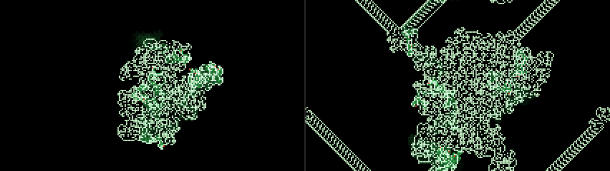
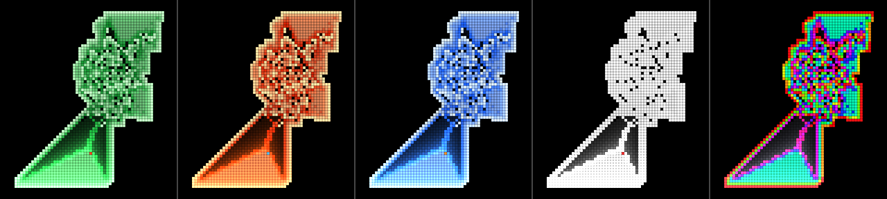

# Langton user guide

Langton is **Langton's ant, for [Resolume](https://resolume.com) Arena and Avenue**, as two FFGL
plugins in one download: **SW Langton**, a source in which one ant (or up to eight) walks an empty
grid or a random soup, and **SW Langton Over**, an effect in which the ants walk your clip, reading
its brightness as the colours of the ground and repainting it as they go.

An ant on a grid of black and white cells turns right on white and left on black, flips the cell
it's standing on and steps forward. That's the whole rule, and nothing in the plugin draws a picture
of an ant's walk. The walk is the rule, run one step at a time, and what you see falls out of it:
ten thousand steps of mess that nobody has ever found any order in, then a highway the ant keeps
building for as long as there's room. Turk and Propp's many-coloured ants are on the Rule dropdown,
up to eight ants can take turns, and the walk runs backwards, so all of it can un-happen into the
empty grid it came from.


*SW Langton at its defaults after 21.7 seconds (12,990 steps), rendered by `lntest`, the offline
harness, rather than captured from Resolume: ten thousand steps of chaos, then the highway heading
off down and to the left. Pale cells are colour 1, the green ones are where the ant has walked
lately (the trail), and the red cell at the end of the highway is the ant.*

> **Before you rely on this:** it's at **v0.1.0**, the first release, and early days. The ant is
> measured rather than asserted, by a harness (`lntest`) that drives the plugins' own classes in a
> headless GL context on an Apple M4 Max, at 1280×720 and 320×180 on the GPU and at 320×180 again
> on Apple's software renderer. It asks the plugin's own walk for the published behaviour and gets
> it: from an empty grid, Langton's ant starts repeating a 104-step cycle at step 9977, each cycle
> carrying it two cells diagonally; LLRR and RLLR are mirror-symmetric every time the ant gets home
> facing up (697 and 533 times in 20,000 steps, against once in 15 for Langton's own ant); and
> LRRRRRLLR fills a square. Every rule matches a walk the harness wrote separately, cell for cell,
> with one ant, with eight, and with four started on the edges of the wrapping grid, and for
> Langton's ant run 12,000 steps through the plugin, the state texture read back off the GPU after
> every frame is that walk, texel for texel. Every rule run out and back, by the clock and by hand,
> ends with every cell and every ant where it started. Each pixel is the painted area it covers, to
> within float rounding; the Over's seed is the clip's levels, cell for cell; and Mix 0 hands the
> clip back bit for bit. Fourteen models broken on purpose and seven one-character changes to the
> shipped code are all caught, and all 35 parameters over both plugins change the picture. On a Mac
> the only host it's run in is the fleet's own test host, `oxbow`, which loads it as `SW Langton`
> (`LA01`, a source) and `SW Langton Over` (`LA02`, an effect) and renders 120 frames through each,
> so it has **never been loaded into Resolume on macOS**.
>
> **On Windows it has been in Resolume.** In Arena 7.27.1 on win-lab (a virtual machine with
> software rendering, no GPU and no sound device), both plugins load and register as `SW Langton`
> and `SW Langton Over`, every control is as declared, both render, and Arena's log stays clean:
> all of the fleet's Arena checks that can run there passed. Each control is measured against a
> still picture, which a walking ant never quite is, so the verdicts are per run. In the source all
> 12 controls it could measure changed the picture; in the Over 15 did and Reverse was too close to
> call. The three audio controls couldn't be tested without a sound device. Software rendering says
> nothing about a GPU, or about speed.
>
> No real audio has reached it anywhere: the audio controls have had the harness's synthetic beats
> and nothing else. The palettes are picked by eye, and the only clip it's been measured on is the
> harness's own test card. There's a browser demo at
> [langton-demo.stoatworks-labs.com](https://langton-demo.stoatworks-labs.com), which has no
> audio. Try it on a spare layer before you put it in a show.
>
> This codebase was created with AI assistance, directed and reviewed by a human author.

---

## Installing

Every download has both plugins in it: **SW Langton** (a source) and **SW Langton Over** (an
effect), as `Langton.bundle` and `Langton Over.bundle` on macOS and `Langton.dll` and
`Langton Over.dll` on Windows.

If you use [Burrow](https://stoatworks-labs.com/software/burrow/), my installer for the whole
fleet, Langton is on its Video tab and it'll put both plugins in the right folder for you.

By hand, download them from the [GitHub release](https://github.com/stoatworks-labs/langton/releases),
drop both into Resolume's effects folder and restart Resolume:

```
macOS    ~/Documents/Resolume Arena/Extra Effects/
Windows  %USERPROFILE%\Documents\Resolume Arena\Extra Effects\
```

Avenue uses the same layout under its own folder name. SW Langton shows up among the sources and
SW Langton Over in the effects browser.

The macOS download is a universal build (Apple silicon and Intel), as a `.dmg` or a `.zip`. It's
Developer ID-signed and notarised by the release pipeline after publication, so the bundles just
load. If macOS refuses a download, it's from before the signing, so download it again. The Windows
download is an x64 installer or a `.zip`. It isn't code-signed, so the installer trips SmartScreen
once: **More info** → **Run anyway**.

---

## One ant, and everything falls out of it

The field is a grid of cells and an ant standing on one of them, facing up, down, left or right.
Every step, the ant:

- turns a quarter turn **right** if its cell is **empty**, or **left** if it's **painted**;
- flips the cell: empty becomes painted, painted becomes empty;
- steps forward one cell.

That's Christopher Langton's rule from 1986, and it's all there is. (In his description the grid
starts white, so here the empty colour, drawn as nothing, is his white, and the painted one, drawn
pale, is his black.) Nobody draws the shapes. They're what the rule does:

| what you see | why |
| --- | --- |
| **small patterns, often symmetric** | the first few hundred steps, on a grid that's still nearly empty |
| **a growing blob of mess** | from then until step 9977: a walk nobody has found any order in, though every step of it is fixed by the rule |
| **a highway** heading off diagonally | from step 9977 the ant repeats the same 104 steps, and each time round it ends up two cells further along with the same cells round it |
| **the highway coming back in on the other side** | the grid wraps: off the left edge is the right edge, and off the bottom is the top |
| **new mess where the highway meets old work** | the cycle only repeats over empty cells, so when the highway reaches anything painted the ant goes back to making a mess |

**Why the highway appears at all** is an open question. Every finite starting pattern anyone has
tried ends in one sooner or later, but nobody has proved that it always will; what has been proved
is only that the ant can never stay inside a bounded patch for good. Why it stays on the highway is
easier: after each 104-step cycle it's two cells further along with the same cells round it and
nothing but empty cells ahead, so the next 104 steps go the same way.

The plugin's grid wraps round, though. At the defaults the highway runs off the bottom a little
over 22 seconds in, comes back in at the top, and within a minute it has driven into its own mess.
Road-building programmes the world over have managed the same thing with considerably more
paperwork.

**Turk and Propp's ants** have more colours. A rule is a string of letters, one for each colour, R
for a right turn and L for a left. On a cell of colour *k* the ant turns by the *k*th letter
(counting from 0), moves the cell on to the next colour (the last wraps back to 0), and steps
forward. Langton's ant is **RL**. If the letters pair off into equal pairs when you read them round
in a circle (LLRR, and RLLR, whose last R pairs with its first), the pattern is mirror-symmetric
every time the ant comes back to where it started facing the way it started. Others fill a square,
build a different highway, or never settle at all.

**Every step can be undone**: step back, move the cell's colour back one, undo the turn that colour
gave. So with **Reverse** on, the ants walk their own path backwards and the highway, then the mess,
un-happen into the grid they started from. See *Running it backwards*.

---

## Start here

1. Put **SW Langton** in a clip slot and trigger it. One ant (the red cell) starts in the middle of
   an empty grid and makes a mess, 600 steps a second.
2. Wait. About 16.6 seconds in (step 9977) the mess sprouts a highway, heading off down and to the
   left.
3. Turn **Reverse** on. The ant reels the highway back in and un-makes the mess. Turn Reverse off
   before it gets home, or it carries on walking backwards into a past that never happened.
4. Pick **Rule** *LRRRRRLLR* and press **Reseed** for an empty grid. The ant builds a square round
   itself. Turn **Speed** up to watch it grow.
5. Set **Ants** to 8. The ant jumps back to the middle and seven more join it on a circle round it,
   on the field as it is.
6. For your own footage: put **SW Langton Over** on a clip with bright shapes on a dark ground. Its
   bright parts are the painted cells, and four ants start walking them.

---

## The Automaton group

Resolume shows every slider as 0 to 1, except Ants and Seed, which are whole numbers. The ranges
below are what the slider positions mean.

**Rule** (default *Langton (RL)*). Which rule the ants obey:

| Rule | colours | what it does |
| --- | --- | --- |
| *Langton (RL)* | 2 | simple patterns for a few hundred steps, chaos until step 9977, then the highway |
| *LLRR* | 4 | grows symmetrically, as a rounded blob |
| *RLLR* | 4 | grows symmetrically too, inside a squarer frame with diagonal corners |
| *LRRRRRLLR* | 9 | fills a square round itself: 38 × 38 cells at 20,000 steps, 116 × 116 at 80,000, 164 × 164 at 160,000 |
| *LLRRRLRLRLLR* | 12 | builds a convoluted highway: a knot of chaos, then a wide, braided road |
| *RRLLLRLLLRRR* | 12 | builds a filled triangle that grows and moves |
| *RLR* | 3 | grows chaotically; nobody knows whether it ever builds a highway |

Changing Rule doesn't reseed: the ants carry on over the field as it is, reading each cell's colour
round the new rule's colours, and they're drawn the same way: a cell left in colour 7 by a
twelve-colour rule is colour 1 to a three-colour one, and looks it. Press **Reseed** to see the new
rule from the start.


*The six many-coloured ants, each from an empty grid at 180 rows (Cell Size 0.4254) in Phosphor.
Top row, left to right: LLRR after 150,000 steps, RLLR after 80,000, LRRRRRLLR after 40,000. Bottom
row: LLRRRLRLRLLR after 50,000 (its highway has already wrapped round and come back in on the right,
out of this window), RRLLLRLLLRRR after 25,000 and RLR after 50,000. Rendered by `lntest`, the
offline harness, rather than captured from Resolume; each panel is about 427 × 360 pixels cut from
a 1280 × 720 frame.*

**Ants** (1 to 8; default 1 in the source, 4 in the Over). How many ants walk the field. They take
turns, one step each: a **round** is one step for every ant. The first starts in the middle facing
up, so one ant on an empty grid walks Langton's walk, cell for cell. The rest stand evenly round a
circle whose radius is a sixth of the grid's shorter side (20 cells at the defaults), the second
straight to the right of the first, each facing a quarter turn clockwise from the one before. They
share the grid, so each turns on the colours the others have left. Changing Ants puts every ant
back at its start place; the cells stay as they are.



*Eight ants from an empty grid, everything else at the source's defaults. Left, after 6,000 rounds
(48,000 steps): one shared mess. Right, after 18,000 rounds: highways leaving in several directions
and wrapping round the edges. Rendered by `lntest` rather than captured from Resolume, each a whole
1280 × 720 frame at half size.*

## The Time group

**Speed** (0; then 1 to 1,000,000 rounds a second; default 600 in the source, 3,000 in the Over).
In rounds, so with four ants 3,000 rounds a second is 12,000 steps. Each sixth of the slider is ten
times faster than the last: 10 at 0.17, 100 at 0.33, 1,000 at the middle, 10,000 at 0.67, 100,000
at 0.83. The defaults sit at 0.463 and 0.58. At 0 the ants stand still, and only Step and Audio
Burst move them. After any number of frames at any frame rate, the ants have walked Speed × the time
elapsed, rounded down. At most 100,000 rounds run in a frame, Step and Audio Burst included, and
anything past that is dropped rather than saved up: at a million a second below ten frames a second
the ants fall behind Speed rather than lurching to catch up.

**Reverse** (off by default). Time runs backwards. It's combined with Audio Reverse: either one on
its own runs time backwards, both together run it forwards.

**Step** (a button). One round, by hand, in whichever direction time is running.

## Running it backwards

With **Reverse** on, each round is undone: each ant steps back the way it came, moves the cell it
lands on back one colour and undoes the turn that colour gave, and the ants go in the opposite order,
so whatever they did to each other's cells comes apart in the right order. Run as many rounds back
as you ran out and every cell's colour and every ant's place and heading are where they started,
bit for bit. The harness checks that for every rule, with a soup and four ants, and for Langton's
ant 12,000 steps into the highway and back to an empty grid.


*SW Langton at its defaults. Top left, 12,000 steps out. Top right, after 6,000 steps with Reverse
on: the highway is gone and its ghost glows in the trail. Bottom left, all 12,000 steps back: not
one cell painted, the ant home in the middle, the trail still glowing. Bottom right, for comparison,
a fresh run of 6,000 steps: the same cells as top right, without the ghost (with Trail at 0 the two
are identical, pixel for pixel). Rendered by `lntest` rather than captured from Resolume, each panel
a 640 × 360 window of a 1280 × 720 frame.*

Reverse undoes **the walk**. It doesn't undo what you did to the field:

- **a Rule change.** Run back past one and the ants walk the earlier rounds backwards under the new
  rule, which isn't how they were walked.
- **an Ants change**, which put every ant back at its start place.
- **a Cell Size change that cut cells off.** The cropped cells are gone.
- **a reseed**: Reseed, a Seed change or a Pattern change.
- **the trail.** It's timed by every step the ants take, either way, so cells walked back over glow
  as brightly as cells walked forwards, and keep glowing (and fading) after their colour has gone
  back. That's the ghost above. Trail at 0 hides it.

It doesn't stop at the start, either. Run back past the seed and the ants carry on, by the same
rule, into a past that never happened: a field that, run forwards, would have become your empty
grid. Turn Reverse off and they walk back to it, and on into the walk you had.

## The Seeding group

**Pattern** (*Empty*, *Soup*, and in the Over *Clip*; default *Empty* in the source, *Clip* in the
Over). What the field starts from, and what Reseed lays down. *Empty* is Langton's own start.
*Soup* gives each cell a random colour, from 1 to the rule's last, with chance Density, and leaves
the rest empty. *Clip* is the clip's brightness; see *SW Langton Over*. Choosing a pattern reseeds.

**Density** (0 to 1, default 0.2). The soup's fill, from the next reseed.

**Seed** (0 to 9999, default 1). Which soup: on the same grid and rule, the same Seed always gives
the same first soup. Changing Seed reseeds, whatever the pattern.

**Reseed** (a button). Starts again: the ants back at their start places, the trail cleared, and
the ground laid down again, as an empty grid, the next soup in the Seed's sequence, or the clip as
it is now.

## The Audio group

**Audio** (Resolume's FFT input). The plugin listens for onsets, measured against the sound's own
recent peak, so a quiet track fires about as readily as a loud one. The first frame after a clip
trigger fires nothing, even if the music is already loud.

**Audio Burst** (0, then 10 to 100,000 rounds an onset; default 0). Each onset walks the ants this
many rounds at once, in whichever direction time is running: 100 at 0.25, 1,000 at the middle,
10,000 at 0.75. With Speed at 0, the ants only move on the beat.

**Audio Reverse** (off by default). Each onset turns time round. With Audio Burst as well, the onset
turns time round first and then runs its burst.

Turn Audio Reverse off and time follows **Reverse** again, whatever the onsets left it at. (Until
just before release it didn't: the last onset's direction outlived the switch, and the ants could
walk backwards with Reverse off. The harness now checks that it doesn't.)

## The Look group

**Cell Size** (default 120 rows: 9 pixels at 1080p). From a cell a pixel tall at 1080p (1080 rows)
to sixteen rows, geometrically: 377 rows at 0.25, 131 at the middle, 46 at 0.75; the default is at
0.52. The columns follow the output's shape (213 at 16:9), so cells stay square. The grid doesn't
depend on the output's size, so a resize to the same shape keeps the walk cell for cell. A change
of Cell Size or of the output's shape keeps the cells round the middle: bigger cells crop the field
(the cells cropped are gone for good), smaller ones add empty margins, and the ants keep their
places relative to the middle.

**Gap** (0 to half a cell, default 0.2: a tenth of a cell). Dark space between neighbouring cells.
Each cell, its trail and any ant on it are drawn as a square inset by half the Gap on every side.

**Palette** (*Phosphor*, *Heat*, *Ice*, *Mono*, *Spectrum*; default *Phosphor*). Colour 1 is the
palette's first colour and the rule's last colour its last, with the ones between spread evenly.
Colour 0 is never drawn.

| palette | colour 1 → last colour | trail | ant |
| --- | --- | --- | --- |
| *Phosphor* | pale green → deep green | green | red-orange |
| *Heat* | pale yellow → deep red | orange | pale blue |
| *Ice* | near white → deep blue | blue | orange |
| *Mono* | white, every colour | grey | red |
| *Spectrum* | round the hue wheel from red | cool grey | white |

Langton's two-colour rule only ever paints colour 1, so its picture is the palette's first colour
(Spectrum's red), the trail and the ant.



*RRLLLRLLLRRR (twelve colours) after 20,000 steps at 180 rows: left to right Phosphor, Heat, Ice,
Mono and Spectrum. Rendered by `lntest` rather than captured from Resolume; each panel is a
256 × 288 window of a 1280 × 720 frame.*

**Trail** (off; 10 to 1,000,000 steps; default 3,000). How long a cell glows after an ant has stood
on it: the glow falls by a factor of e every Trail steps. Geometric: 100 at 0.2, 1,000 at 0.4,
10,000 at 0.6, 100,000 at 0.8; the default is at 0.495. It's counted in **ant steps**, every ant's,
not seconds: at the defaults that's five seconds in the source (3,000 steps at 600 a second) and a
quarter of a second in the Over (four ants at 3,000 rounds a second). With Speed at 0 the trail
holds still too.

**Show Ants** (on by default). Each ant drawn as its cell, in the palette's ant colour.

The Over only:

**Clip Colour** (0 to 1, default 0). The painted cells take the clip's colour under them. At 1, with
Backdrop 0, they're windows onto the clip. The ants take the clip's colour too, so at 1 they vanish
into it.

**Backdrop** (0 to 1, default 0.35). How much of the clip shows where nothing is painted, and in the
gaps.

**Mix** (0 to 1, default 1). The whole effect against the clip. At 1 the output is opaque whatever
the clip's alpha; at 0 the clip comes back untouched, alpha and all.

---

## SW Langton Over: your clip is the ground

The clip decides the field's colours **once**, when the field is seeded: when the effect loads, and
when you press Reseed, change Seed or choose *Clip* in Pattern. Each cell looks at the one pixel
under its centre and takes its brightness, the brightest of red, green and blue times the alpha, so
a saturated blue counts as bright as a white. That's cut into as many levels as the rule has
colours, level *k* of *n* covering *k*/*n* up to (*k*+1)/*n*. Under Langton's rule, anything
brighter than half is painted and the rest is empty; under LLRR the four quarters of the range
become colours 0 to 3.

Then the ants walk it, turning by what the picture says and repainting it as they go, and the clip
doesn't touch the field again until the next seed. A moving clip shows through only as Backdrop,
Clip Colour and Mix. I decided against feeding the clip in continuously, the way Conway's Over does:
it would paint over the ants' work every frame, and there'd be no walk left to look at.


*SW Langton Over on the harness's test card (a lit skyline, a ring and a saturated blue sign on a
dark ground). Top left, the card itself (Mix 0). Top right, the seed (Speed 0, Backdrop 0):
everything brighter than half is a painted cell, the blue sign included, and the four ants are at
their start places. Bottom left, five seconds on at the defaults with Backdrop 0. Bottom right, the
same with Clip Colour 1: the cells are windows onto the card, and the ants have vanished into it.
Rendered by `lntest` rather than captured from Resolume, each panel a whole 1280 × 720 frame at half
size.*

- **There's no threshold.** The levels are fixed, so a clip that never gets brighter than half
  seeds nothing under Langton's rule, and one that's bright almost everywhere seeds a solid block.
  Change the clip's brightness ahead of the effect, or try a rule with more colours.
- **With more colours, the brightest parts come out darkest** in Phosphor, Heat and Ice: the top
  level is the rule's last colour, the deep end of the ramp. Clip Colour 1 gives the cells the
  clip's own colours back.
- **Reverse brings the clip back.** Its seed is a field like any other: in the harness, 15,000
  rounds out with four ants and 15,000 back returned to the seed pixel for pixel, with Trail at 0.
- With Pattern *Empty* or *Soup* the clip isn't read at all, and nothing in the code reseeds on a
  clip trigger. (How Resolume treats a retriggered clip hasn't been tried on a Mac.)

---

## The source is transparent where nothing is painted

SW Langton's output is premultiplied. Empty cells are transparent, so the field layers over
whatever is below it, and the trail on an empty cell fades out through partial transparency. Use it
on Add or Screen for a glow, or Alpha to lay the cells over a picture.

---

## Recipes

**The highway, on cue.** From an empty grid the highway starts 9,977 steps in, so it arrives
9,977 ÷ Speed seconds after a reseed: 16.6 seconds at the default, ten at 1,000 a second (the middle
of the slider). Set Speed for the bar you want and press Reseed on the downbeat that counts. Trail
at 0.3 (about 300 steps) keeps the glow to the ant's last few hundred steps.

**The rewind.** Let Langton's ant run well into its highway, then turn **Reverse** on for the
chorus. The highway reels in and the mess un-makes itself; turn Speed up to rewind faster. Turn
Reverse off just before it gets home, or let it walk out into the past that never happened, which,
it turns out, makes a mess and then a highway of its own, heading the other way.

**Flicking between now and a moment ago.** Once the ants have built something, set Speed to 0,
**Audio Burst** to 0.5 (1,000 rounds an onset) and **Audio Reverse** on. The first onset turns time
round and walks 1,000 rounds back; the next turns it round again and walks them forwards. So the
picture flips between where it was and 1,000 rounds earlier on every hit, landing on the same two
pictures every time (checked in the harness with its synthetic beat). With Speed at 1,000 and Audio
Burst at 0 instead, the ants pace back and forth with the music and don't get far. Turn Audio
Reverse off and they go whichever way Reverse says.

**Ants chewing a logo.** Put **SW Langton Over** on a white logo on black. Four ants start in the
middle and chew into it. Backdrop 0 and Clip Colour 1 keep the logo's own colours; Speed 0.45 (about
500 rounds a second) and Trail 0.6 make it a slow, glowing nibble rather than a feeding frenzy.
**Reverse** puts the logo back cell for cell, **Reseed** puts it back at once.

**A square for a big wall.** Rule *LRRRRRLLR*, Pattern *Empty*, Cell Size 0.25 (377 rows) and Speed
0.67 (10,000 rounds a second). The square grows round the ant, 164 cells across after 160,000
steps, about sixteen seconds in.

---

## How it works

- **The walk** runs on the CPU, in whole numbers: a colour for every cell (up to twelve), whether an
  ant has ever stood on it, and when it last did. The ants take turns in order, and in reverse
  order backwards. The grid wraps at every edge, which keeps every step reversible.
- **Time** is Resolume's clock, taken frame to frame in double precision, since it runs to
  hundreds of millions of milliseconds. Whole rounds run and the fraction carries; a jump in the
  clock, backwards or more than a second forwards, passes no time.
- **The state texture.** Each frame the rows the ants touched go up to the graphics card as an
  integer texture, one texel a cell. The graphics card never computes the walk, only draws it.
- **The picture** averages the grid over each pixel's footprint, weighting every cell by the area of
  its painted square the pixel covers, so a cell a fraction of a pixel wide is drawn evenly.
- **The Over's seed** is a pass that reads the clip at each cell's centre, cuts it into the rule's
  levels and hands them to the walk, once a seed.

---

## Performance

Measured by the offline harness (`lntest --bench`) on an Apple M4 Max shared with other work, the
median frame at the defaults:

| | SW Langton | SW Langton Over |
| --- | --- | --- |
| 1280×720 | 0.28 ms | 0.17 ms |
| 1920×1080 | 0.36 ms | 0.27 ms |
| 3840×2160 | 0.34 ms | 0.68 ms |

That's 1–4% of a 60 fps frame. The walk runs on the CPU, so its cost grows with Speed and Ants, not
with the output's size. The worst case, a million rounds a second with eight ants on 1080 rows,
measured **3.4–4.3 ms a frame** (20–26% of a 60 fps frame) when it was built; the runs for this
release came out between 3.8 and 6.6 ms on a busier machine, so allow for the top of that. Nothing was timed inside Resolume, and nothing
was timed on Windows.

---

## If it looks wrong

**It's just a mess.** That's the first ten thousand steps. At the defaults the highway starts about
16.6 seconds after the field was seeded; turn Speed up to get there sooner.

**The highway came back in on the other side, or turned into mess again.** The grid wraps, and the
highway sooner or later walks into old work. More rows (a smaller Cell Size) puts that off.

**The colours jumped when I changed Rule.** The field keeps its cells, and they're read round the
new rule's colours, so a cell's colour can land somewhere else on the palette's ramp. Press Reseed
for the new rule on its own.

**Reverse didn't take me back to where I started**, or the empty grid is still glowing. See the
list under *Running it backwards*.

**The Over's trail is gone in a blink.** Trail counts ant steps, and four ants at 3,000 rounds a
second burn through 3,000 steps in a quarter of a second. Raise Trail, or lower Speed.

**The Over shows almost no cells, or a solid block.** The clip is mostly darker, or brighter, than
the level cut (half, under Langton's rule). There's no threshold control: change the clip's
brightness ahead of the effect.

**The Over doesn't follow my clip.** It reads the clip once, at the seed. Press Reseed.

**The ants have disappeared.** Show Ants is off, or in the Over Clip Colour is near 1 and they've
taken the clip's colour.

**Neither plugin is in the browser.** Check the folder under *Installing*, and that Resolume was
restarted.

**It does nothing at all.** That's what a shader that won't compile looks like. The actual error is
in the log:

```
macOS    ~/Library/Logs/langton/langton.YYYY-MM-DD.log
Windows  %LOCALAPPDATA%\langton\logs\langton.YYYY-MM-DD.log
```

It records the GL vendor, renderer and version at load, which shader failed if one did, and whether
the state buffers couldn't be allocated.

---

## Known limits

- **Never loaded into Resolume on macOS.** Everything numeric was compiled, rendered and measured
  offline against the plugins' own classes in a headless GL context, plus a load in `oxbow`. On
  Windows, see the box at the top.
- **No real audio** has reached it on a Mac, only the harness's synthetic beats, and nobody has
  measured what Resolume's FFT bins hold.
- **The grid is a torus**, with no dead edges: that's what keeps the walk reversible, and it's why
  the highway runs into its own mess.
- **What Reverse can't undo** (a Rule, Ants or Cell Size change, a reseed, the trail) is under
  *Running it backwards*.
- **The Over reads the clip once**, from one pixel per cell, at fixed levels with no threshold.
- **The walk is on the CPU**, at most 100,000 rounds a frame, with at most eight ants and twelve
  colours.
- **The palettes and the trail are chosen by eye**: a look, not a measurement of anything.
- **The literature was checked against Wikipedia** for this release, and every published number
  quoted here (the highway at 9977, its 104-step cycle, the symmetry, the square) is reproduced by
  the harness from the plugin's own walk.
- **The only clip it's been measured on is the harness's test card.** It's never been seen on
  camera footage.
- **Only ever run on an Apple M4 Max** on a Mac, although the macOS build contains an Intel slice,
  and in Arena on Windows only under software rendering.
- **No presets**, and no OpenFX version.
- **There is a browser demo** at [langton-demo.stoatworks-labs.com](https://langton-demo.stoatworks-labs.com).
  It's a port to a web page, not the plugin itself, and it has no audio.

---

## About

The last group, **About**, has the plugins' name, version, licence and maker, and buttons that open
this guide, the project page, the source on GitHub and the support page in your browser.

## Links

- Project page: [stoatworks-labs.com/software/langton](https://stoatworks-labs.com/software/langton/)
- Source: [github.com/stoatworks-labs/langton](https://github.com/stoatworks-labs/langton)
- User guide: [stoatworks-labs.com/software/langton/guide](https://stoatworks-labs.com/software/langton/guide/)
- Browser demo: [langton-demo.stoatworks-labs.com](https://langton-demo.stoatworks-labs.com)

## Reporting something

If something's wrong, shout at
[github.com/stoatworks-labs/langton/issues](https://github.com/stoatworks-labs/langton/issues).
A screenshot, the Rule, Ants, Speed and Pattern, whether Reverse or Audio Reverse had been on, any
other controls you moved, and the composition's resolution and frame rate are usually enough. If
the plugin did nothing, attach the log.

Langton's ant is Christopher Langton's (1986); the many-coloured ants are Greg Turk's and Jim
Propp's.
